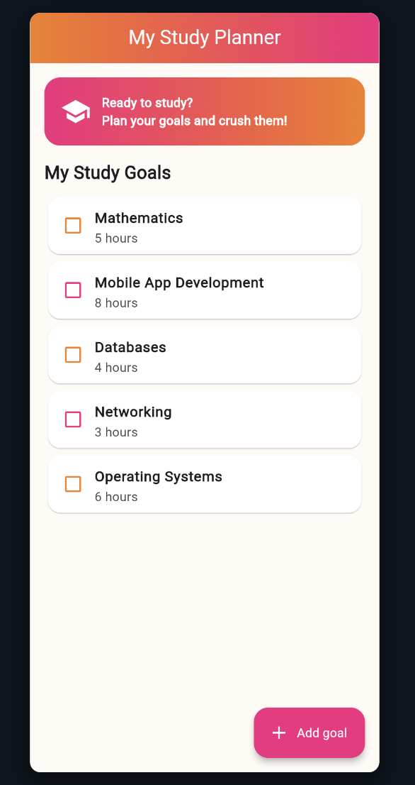
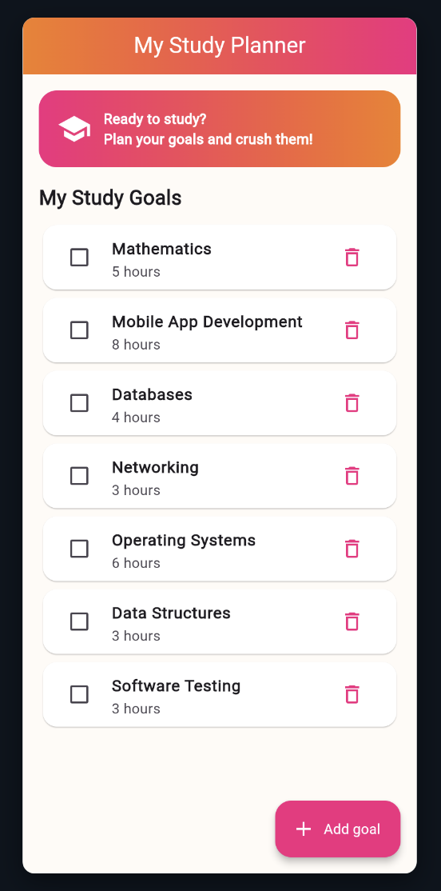
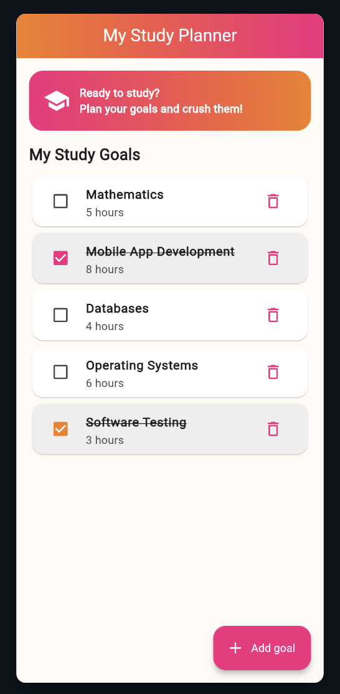

My Study Planner
A Flutter mobile app that helps students plan their study time. You write down what you want to study and for how many hours, tick the goals you finish, and remove the ones you no longer need.
The app is built step by step in 5 phases: a static screen, a working list, statistics, a second screen with a form, and a database so goals are saved when the app closes.

Group 11

+---+---------------------+
| # | Registration number |
+---+---------------------+
| 1 | 25904/2024          |
| 2 | 26057/2024          |
| 3 | 26308/2024          |
| 4 | 26323/2024          |
| 5 | 27444/2024          |
+---+---------------------+

Progress

+-------+------------------------------------------+-------------+
| Phase | What it adds                             | Status      |
+-------+------------------------------------------+-------------+
| 1     | Static screen with fixed goal cards      | Done        |
| 2     | Working list: add, tick and delete goals | Done        |
| 3     | Statistics and cards                     | Not started |
| 4     | Second screen with a validated form      | Not started |
| 5     | Database with sqflite                    | Not started |
+-------+------------------------------------------+-------------+

Design

An orange and pink palette (#F57E1E and #F52380) on a warm off-white background, with a gradient AppBar and banner and white rounded goal cards.
Phase 1: Static screen
Fixed content only: a gradient AppBar, a welcome banner, the heading "My Study Goals", five goal cards and an "Add goal" button that does nothing yet.

  

Phase 2: Working list
The goals are now stored in a list and every change updates the screen. The "Add goal" button adds a goal, tapping a card ticks it as done, and the bin icon removes it.
Adding new goals

  

Selecting and removing goals

  

